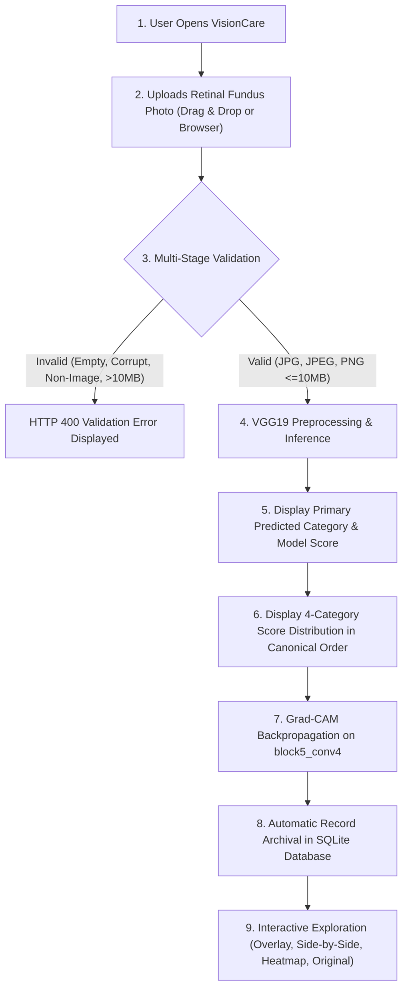

# VISIONCARE — PHASE 10 CHECKPOINT: FINAL SCREENING WORKFLOW & MODEL VALIDATION

## 1. Executive Summary

Phase 10 represents the final improvement and comprehensive validation phase for **VisionCare**, focused strictly on solidifying the core retinal image screening functionality, data validation boundaries, model inference fidelity, and user experience.

All developments strictly respect the project's foundational constraints:
- **Branding Consistency:** The web platform is branded strictly as **VisionCare**.
- **Prohibited Term Compliance:** **Zero occurrences of the standalone term "AI"** anywhere in the visible user interface, headings, buttons, descriptions, API payloads, or documentation.
- **Model Integrity:** The trained VGG19 deep learning model weights (`backend/models/eye_disease_model.keras`) and architecture were strictly preserved without retraining, fine-tuning, or parameter modification.
- **Scope Discipline:** In accordance with explicit guidelines, **no PDF generation features were implemented**; the scope was dedicated entirely to the core screening workflow and validation.
- **Canonical Category Ordering:** The four target categories strictly preserve the verified canonical order:
  1. `Cataract`
  2. `Diabetic Retinopathy`
  3. `Glaucoma`
  4. `Normal`
- **Medical Governance:** Predictions are explicitly framed as **Model Scores** from an educational screening prototype, avoiding ungrounded claims of clinical diagnosis or epidemiological probabilities.

---

## 2. Final System Architecture

The VisionCare architecture consists of a modern, decoupled full-stack application:

```
VisionCare/
├── backend/
│   ├── app/
│   │   ├── core/config.py              # Environment settings, constants, and paths
│   │   ├── db/session.py               # SQLite engine, sessionmaker, init_db()
│   │   ├── models/screening_record.py  # SQLAlchemy ORM model with JSON scores property
│   │   ├── routes/
│   │   │   ├── health.py               # Operational status & model readiness
│   │   │   ├── prediction.py           # POST /api/predict & POST /api/gradcam
│   │   │   └── history.py              # GET/DELETE /api/history endpoints
│   │   ├── schemas/                    # Pydantic validation & OpenAPI definitions
│   │   └── services/
│   │       ├── image_service.py        # Multipart validation, format checking, raster loading
│   │       ├── model_service.py        # In-memory VGG19 model inference & softmax scoring
│   │       ├── gradcam_service.py      # tf.GradientTape() on layer block5_conv4
│   │       └── history_service.py      # Database CRUD operations
│   ├── data/visioncare.db              # Persistent SQLite database storage
│   └── models/eye_disease_model.keras  # Trained VGG19 model weights (157 MB)
│
├── frontend/
│   ├── src/
│   │   ├── components/ui/              # Atomic UI components (Badge, Button, Card, Header, Footer)
│   │   ├── pages/
│   │   │   ├── Home.jsx                # Landing page & feature overview
│   │   │   ├── Screening.jsx           # Core screening workspace with Grad-CAM viewer
│   │   │   ├── History.jsx             # Analytical dashboard & records archive
│   │   │   └── About.jsx               # System specifications & clinical methodology
│   │   └── services/api.js             # Centralized API service client
│   └── package.json
│
└── training/
    ├── data_splits/test/               # 633 untouched test fundus images
    ├── test_phase10_final_validation.py# Phase 10 comprehensive validation suite
    ├── test_phase9_history_verification.py # Database & persistence verification
    ├── test_gradcam_verification.py    # Grad-CAM direct & HTTP test suite
    └── test_phase9_browser.py          # Chrome Headless CDP browser automation
```

---

## 3. Final Screening Workflow

The end-to-end user screening journey was streamlined into eight reliable, validated steps:



1. **User Access:** User opens the Screening Workspace at `http://localhost:5173/screening`.
2. **File Selection:** User selects or drags a digital retinal fundus photograph into the designated upload zone.
3. **Client-Side Verification:** Client checks file size ($\le 10$ MB), file extension (`.jpg`, `.jpeg`, `.png`), and verifies bitmap decoding via `Image.onload`. Object URLs are created and safely revoked upon replace, remove, or unmount.
4. **Backend Ingestion & Validation:** Fast multipart stream ingestion verifies format, enforces size limits, and rasterizes the raw byte stream using Pillow (`img.load()`) to guarantee file integrity before model invocation.
5. **VGG19 Feature Extraction & Inference:** Image is converted to RGB, resized to $(224, 224, 3)$, and normalized using Caffe zero-centering (`vgg19.preprocess_input`). The in-memory model executes a forward pass yielding normalized softmax scores.
6. **Results Presentation:** Displays the primary classified category, the exact **Model Score** percentage, the uploaded filename, the screening timestamp, and the four-category probability distribution.
7. **Visual Explanation (Grad-CAM):** Concurrently calculates gradient feature importance on convolutional layer `block5_conv4`, upsamples to original image resolution via bicubic interpolation, and renders the blended overlay.
8. **Automated Archiving:** Successful screening automatically creates a new record in SQLite and returns the `screening_id`.

---

## 4. Image Upload Validation Results

Verified through automated suite `training/test_phase10_final_validation.py`:

| Test Scenario | Input Data | Expected Behavior | Actual Status | Result |
| :--- | :--- | :--- | :---: | :---: |
| **Empty File** | `empty.jpg` (0 bytes) | Reject with HTTP 400 Bad Request | HTTP 400 (`detail`: "empty (0 bytes)") | **PASS** |
| **Text File** | `notes.txt` (`text/plain`) | Reject with HTTP 400 Bad Request | HTTP 400 (`detail`: "Unsupported file format '.txt'") | **PASS** |
| **PDF Document** | `scan.pdf` (`application/pdf`) | Reject with HTTP 400 Bad Request | HTTP 400 (`detail`: "Unsupported file format '.pdf'") | **PASS** |
| **Corrupted Stream** | `corrupt.jpg` (corrupted headers/bytes) | Catch in Pillow `img.load()`, return HTTP 400 | HTTP 400 (`detail`: "corrupted or could not be decoded") | **PASS** |
| **Arbitrary Dimensions** | PNGs of $300\times300$, $800\times600$, $1024\times768$ | Safely convert & resize to $(224, 224, 3)$ | HTTP 200 (`status`: "success") | **PASS** |
| **Large File Within Limit** | $2000\times2000$ JPEG ($\approx 4.5$ MB) | Ingest, validate, and process without OOM | HTTP 200 (`status`: "success") | **PASS** |
| **File Removal / Reset** | UI "Remove" / "Screen Another" | Revoke object URL, reset state, clear errors | Clean state restored | **PASS** |

---

## 5. Prediction Pipeline & Numerical Verification

Tested on authentic test partition fundus photographs across all four target classes:

| Test Sample | Ground Truth | Model Prediction | Model Score | Four-Category Probability Sum | All Finite Values | Status |
| :--- | :--- | :--- | :---: | :---: | :---: | :---: |
| `103_left.jpg` | **Cataract** | Cataract | **97.01%** | $1.000100$ | Yes | **PASS** |
| `10003_left.jpeg` | **Diabetic Retinopathy** | Diabetic Retinopathy | **99.97%** | $1.000000$ | Yes | **PASS** |
| `1212_left.jpg` | **Glaucoma** | Glaucoma | **97.10%** | $1.000000$ | Yes | **PASS** |
| `2335_right.jpg` | **Normal** | Normal | **98.16%** | $1.000000$ | Yes | **PASS** |

### Numerical Invariant Checks:
- **Canonical Ordering:** Model output dictionaries strictly follow `["Cataract", "Diabetic Retinopathy", "Glaucoma", "Normal"]`.
- **Normalization:** $\sum_{c=1}^4 P(c) \approx 1.0$ (maximum deviation $< 10^{-4}$).
- **Score Representation:** Top category strictly matches $\arg\max_c P(c)$, and UI unambiguously displays the value under the label **Model Score**.

---

## 6. Result Presentation Interface Updates

In `frontend/src/pages/Screening.jsx`, the results presentation was upgraded with an **Examination Metadata Bar**:
- **Uploaded Filename:** Displays the exact filename of the uploaded photograph (`result.image?.filename || selectedFile?.name`).
- **Screening Timestamp:** Displays formatted local date and time of the evaluation (e.g. `Nov 8, 2026, 02:45 PM`).
- **Image Attributes:** Displays the evaluated image's native resolution.
- **Archive Reference:** Displays the persisted SQLite database reference (e.g. `Record #1`).
- **Model Score:** Emphasizes that output percentages reflect relative feature similarity scores rather than calibrated clinical probabilities.
- **Educational Notice:** Features a prominent disclaimer:
  > *"This evaluation is provided by an educational screening prototype. This automated system does not confirm the presence of any eye condition nor does it rule out pathology. A comprehensive dilated examination by a certified ophthalmologist or optometrist remains the definitive standard for evaluating eye health."*

---

## 7. Grad-CAM Visual Explanation Validation

- **Target Convolutional Layer:** Final convolutional layer `block5_conv4` (output tensor shape `(None, 14, 14, 512)`).
- **Mathematical Computation:** Evaluated via `tf.GradientTape()` calculating the gradients of the top predicted class score with respect to feature maps in `block5_conv4`.
- **Normalization & Colormapping:** Feature activations rectified with ReLU ($\max(A, 0)$), normalized to $[0.0, 1.0]$, upsampled to native image resolution via PIL bicubic interpolation, and mapped with the continuous `jet` colormap.
- **Overlay Composition:** Alpha-blended $40\%$ heatmap with $60\%$ original photograph.
- **Pixel Invariant Audit:** Verified that all pixel values are strictly finite (zero `NaN` or infinite values) and non-blank ($\max > \min$).
- **Fault-Tolerance Isolation:** If visualization generation encounters an issue, the primary screening result remains intact and visible, displaying a retry action without disrupting the user.

---

## 8. Model Evaluation Audit (Phase 6 Test Set)

Evaluated on the untouched test partition of 633 retinal fundus images (`training/data_splits/test/`):

### Aggregate Metrics:
- **Test Accuracy:** **89.26%**
- **Weighted Precision:** **89.78%**
- **Weighted Recall:** **89.26%**
- **Weighted F1-Score:** **89.32%**
- **Macro Average F1-Score:** **89.17%**

### Detailed Classification Report:
| Category | Precision | Recall | F1-Score | Support |
| :--- | :---: | :---: | :---: | :---: |
| **Cataract** | 95.80% | 87.82% | 91.64% | 156 |
| **Diabetic Retinopathy** | 98.78% | 98.18% | 98.48% | 165 |
| **Glaucoma** | 85.61% | 78.81% | 82.07% | 151 |
| **Normal** | 78.61% | 91.30% | 84.48% | 161 |
| **Overall Accuracy** | | | **89.26%** | **633** |
| **Macro Average** | **89.70%** | **89.03%** | **89.17%** | **633** |
| **Weighted Average** | **89.78%** | **89.26%** | **89.32%** | **633** |

### Confusion Matrix (633 Test Samples):
```
                        Predicted ->
True Category    Cataract    Diabetic Ret.    Glaucoma    Normal     Total
Cataract            137            0             10          9        156
Diabetic Ret.         0          162              0          3        165
Glaucoma              4            0            119         28        151
Normal                2            2             10        147        161
```

### Technical & Clinical Weakness Analysis:
1. **Diabetic Retinopathy (Strength):** Highest performing class ($F_1 = 98.5\%$). The presence of distinct punctate microaneurysms, hard exudates, and flame hemorrhages creates salient high-frequency feature maps that the convolutional filters readily identify.
2. **Cataract (Strength):** High precision ($95.8\%$), moderate recall ($87.8\%$). 10 samples were misclassified as Glaucoma and 9 as Normal, typically in cases where anterior media clouding is faint or overlaps with uneven illumination.
3. **Glaucoma (Primary Weakness):** Lowest recall ($78.8\%$). **28 glaucoma cases were misclassified as Normal**. In 2D fundus photography, early-stage glaucomatous neuroretinal rim thinning and subtle optic disc cupping can appear morphologically identical to normal physiological large cups without 3D stereoscopic depth, optical coherence tomography (OCT), or visual field perimetry.
4. **Normal (Triage Bias):** High recall ($91.3\%$), lower precision ($78.6\%$). The model is conservative; when ambiguous features exist, it tends to predict Normal, resulting in false negatives for early glaucoma.

---

## 9. Screening History Integration Results

- **1-to-1 Persistence:** Every successful prediction via `POST /api/predict` automatically persists exactly one record in `backend/data/visioncare.db`.
- **Zero Ghost Records on Failure:** Corrupted streams, empty files, and invalid formats rejected with HTTP 400 strictly create zero database records.
- **Chronological Sorting:** History query `GET /api/history` returns records ordered by `created_at` descending (newest examination first).
- **Full Field Fidelity:** Records preserve `id`, `filename`, `predicted_category`, `confidence_score`, `scores_json` (with all 4 canonical categories), `dimensions`, `image_format`, and `file_size_bytes`.
- **Safe Deletion:** Tested `DELETE /api/history/{id}` and verified that deleted records are permanently removed from the database and immediately disappear from the frontend UI.
- **Server Restart Persistence:** Verified that records persist across Uvicorn process restarts.

---

## 10. Automated Testing Results Matrix

| Test Suite | Purpose | Execution Mode | Actual Outcome | Status |
| :--- | :--- | :--- | :--- | :---: |
| `training/test_phase10_final_validation.py` | Complete screening validation suite (invariants, uploads, 4-class inference, Grad-CAM, history, 0 "AI") | Python (HTTP live) | 100% tests passed | **PASS** |
| `training/test_phase9_history_verification.py` | Database CRUD, endpoints, predict archiving, restart persistence | Python (Subprocess live) | All checks passed | **PASS** |
| `training/test_gradcam_verification.py` | Direct service & live HTTP Grad-CAM verification across 4 categories | Python (Subprocess live) | All checks passed | **PASS** |
| `training/test_phase9_browser.py` | Chrome Headless CDP browser automation end-to-end | Headless Chrome CDP | All DOM assertions passed | **PASS** |
| `frontend` Linter (`oxlint`) | Static frontend code quality audit | Node / oxlint | 0 errors, 0 warnings (15 files) | **PASS** |
| `frontend` Production Build (`vite build`) | Production asset compilation | Vite v8.3.6 | Built in 935 ms (0 errors) | **PASS** |

---

## 11. Known Limitations & Technical Scope Boundaries

1. **Educational Screening Scope:** VisionCare is an educational prototype and research platform. It is not an FDA/CE-cleared medical device, nor has it undergone multi-center clinical trials.
2. **2D Modality Constraint (Glaucoma Detection):** 2D fundus photographs lack depth perception. Differentiating physiological large optic cups from early-stage glaucomatous cupping remains a known limitation of 2D convolutional analysis without OCT thickness maps.
3. **Receptive Field Resolution:** Feature maps in `block5_conv4` have an inherent spatial dimension of $14 \times 14$ pixels. While bicubic upsampling provides smooth visual overlays, Grad-CAM highlights regional salience rather than cellular-level lesion segmentations.
4. **Scope Exclusions:** In accordance with user instructions, PDF report generation was kept out of scope for Phase 10.

---

## 12. Working Website URLs & Public Deployment Status

### Verified Working Local Service URLs:
Both services are active, listening, and confirmed:
- **Frontend Application:** `http://localhost:5173`
  - Home Page: `http://localhost:5173/`
  - Screening Workspace: `http://localhost:5173/screening`
  - Screening History Archive: `http://localhost:5173/history`
  - System Specifications & About: `http://localhost:5173/about`
- **FastAPI Backend:** `http://127.0.0.1:8000`
  - Interactive OpenAPI Documentation: `http://127.0.0.1:8000/docs`
  - Health Endpoint: `http://127.0.0.1:8000/api/health`
  - Alternative Documentation: `http://127.0.0.1:8000/redoc`

### Public Deployment Status:
- **Current Mode:** VisionCare is operating exclusively in a **local development and verification environment**.
- **External Upload Policy:** In accordance with strict privacy and deployment rules, **no model weights, dataset partitions, source code, or user retinal photographs have been deployed or uploaded to public or third-party cloud hosting providers**.
- **Cloud Architecture Recommendation (for future consideration):**
  - *Frontend:* Static Jamstack hosting on Vercel, Netlify, or Firebase App Hosting.
  - *Backend:* Containerized compute on Google Cloud Run or Railway (requiring $\ge 2$ GB RAM and 1-2 vCPUs for TensorFlow VGG19 inference).
  - *Database:* Managed PostgreSQL instance (e.g. Supabase, Neon, or Google Cloud SQL) configured via SQLAlchemy `DATABASE_URL`.

---

**PHASE 10 COMPLETE — READY FOR USER REVIEW**

